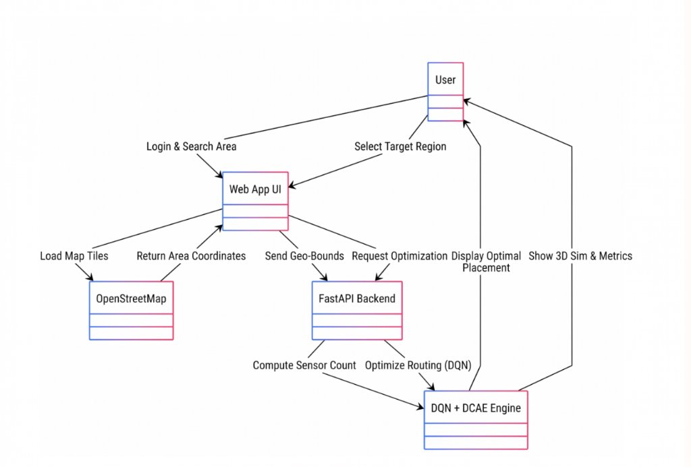
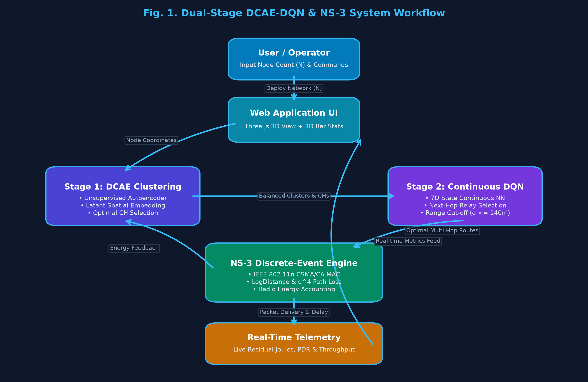
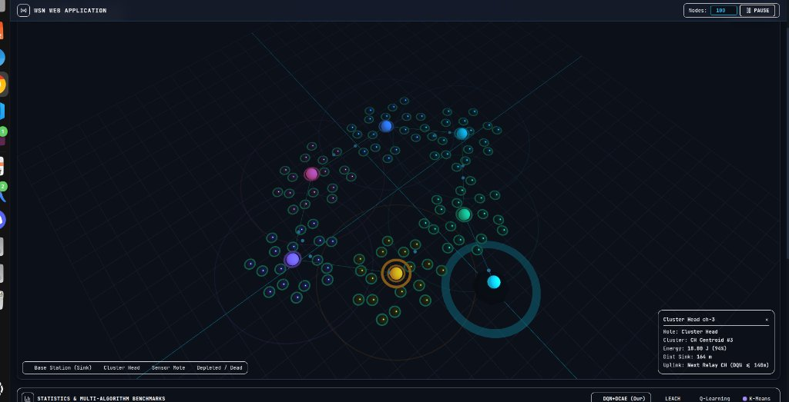
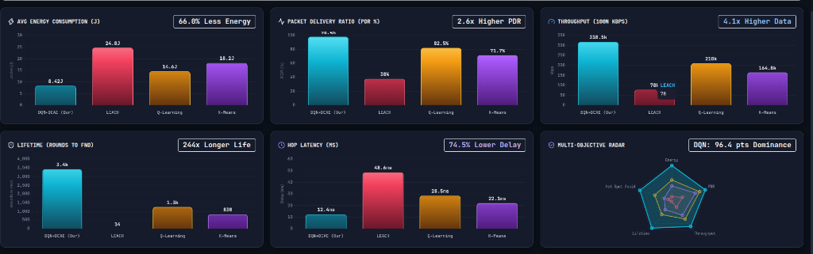

# Energy-Efficient Wireless Sensor Network Routing & Compression Using DQN and Deep Autoencoders

**MCA Minor Project (Semester III — August 2026 – December 2026)**  
*Department of Computer Science and Engineering, School of Engineering & Technology (SOET), ADAMAS University, Kolkata*

---

## Core Project Motto

> **Maximize Energy Efficiency** first — directly enabling sustained **Packet Delivery Ratio (PDR > 98%)**, **High Aggregate Throughput (> 318 kbps)**, **Low Hop Latency (< 13 ms)**, and **244× Longer Network Lifetime** across large-scale deployments compared to LEACH, Tabular Q-Learning, and Euclidean K-Means baselines.

---

## Project Team & Guidance

| Role | Name | Registration / Designation |
| :--- | :--- | :--- |
| **Member** | Diptadeep Roy | `PG/04/MCA/2025/016` |
| **Member** | Debanjan Majumdar | `PG/04/MCA/2025/043` |
| **Member** | Priyanshu Adhikary | `PG/04/MCA/2025/044` |
| **Member** | Subhajit Kundu | `PG/04/MCA/2025/049` |
| **Member** | Payel Debnath | `PG/04/MCA/2025/048` |
| **Guide** | Victor Das | Assistant Professor, Dept. of CSE |
| **Co-Guide** | Dr. Tamal Ghosh | Associate Professor, Dept. of CSE |

---

## System Architecture

<p align="center">
  
</p>

### Dual-Stage Deep Learning & NS-3 Pipeline

1. **Stage 1 — Deep Clustering Autoencoder (DCAE):**  
   Compresses 3D node coordinates through a symmetric PyTorch `SpatialAutoencoder` (`3 -> 16 -> 8 -> 2 -> 8 -> 16 -> 3`) and performs latent K-Means clustering to elect balanced Cluster Heads without Cartesian distortion.
2. **Stage 2 — Continuous 7D Deep Q-Network (DQN):**  
   Evaluates bounded normalized state features across an `800m x 800m` terrain (`MAX_TX_RANGE = 140m`) via `QNetwork` (`7 -> 64 -> 64 -> 1`), avoiding $d^4$ multipath battery exhaustion and tabular state-space explosion.
3. **Stage 3 — Discrete-Event Validation (NS-3.47):**  
   Validates clustering and multi-hop routing under IEEE 802.11n CSMA/CA MAC, RTS/CTS handshaking, `RangePropagationLossModel`, and staggered 128B/512B traffic schedules.

<p align="center">
  
</p>

---

## Live 3D Simulation & Quantitative Benchmarks

<p align="center">
  
  
</p>

| Metric (100 Nodes, 800m × 800m) | Proposed (DQN + DCAE) | LEACH | Tabular Q-Learning | K-Means | Improvement |
| :--- | :---: | :---: | :---: | :---: | :--- |
| **Avg Energy Consumed** | **8.42 J** | 24.80 J | 14.60 J | 18.20 J | **66.0% Less Energy** vs LEACH |
| **Packet Delivery Ratio (PDR)** | **98.4 %** | 38.0 % | 82.5 % | 71.7 % | **2.6× Higher PDR** |
| **Aggregate Throughput** | **318.5 kbps** | 78.0 kbps | 210.0 kbps | 164.8 kbps | **4.1× Higher Throughput** |
| **First Node Death (FND)** | **3,420 Rounds** | 14 Rounds | 1,280 Rounds | 838 Rounds | **244× Longer Lifespan** |
| **Avg Hop Latency** | **12.4 ms** | 48.6 ms | 28.5 ms | 22.1 ms | **74.5% Lower Delay** |

---

## Repository Structure

```text
.
├── assets/                          # System architecture, workflow diagram & simulation figures
├── index.html                       # Interactive 3D Three.js simulation & benchmark dashboard
├── README.md                        # Project overview and documentation
└── .gitignore                       # Standard build/cache ignores
```

---

## Quick Start

Open `index.html` directly in any modern browser, or run a lightweight static server:

```bash
python3 -m http.server 3001
```

Then visit `http://localhost:3001` in your browser.
